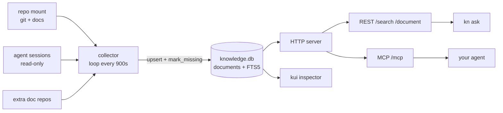

# kn

Per-repository memory for coding agents.

`kn` gives one repository its own searchable knowledge store: git history, docs,
ADRs, schema, runbooks, and your own agent sessions, indexed into one SQLite
file and served over REST and MCP. Three commands, about ten seconds, no
embeddings and no vector database.

```sh
cd ~/code/my-project
kn init
kn up
kn ask why did we choose sqlite
```

```
7 hits · 24 ms · my-project

1. [git] 4f21ac9b — feat: choose sqlite for the bootstrap
   git://my-project/4f21ac9b...
   2026-10-16T18:35:25Z · score 27.4 · my-project
   SQLite keeps the bootstrap self-contained; no database server to provision.

2. [doc] docs/adr/001-storage.md — Decision
   repo://my-project/docs/adr/001-storage.md#L1-18
   2026-10-15T09:12:00Z · score 22.1 · my-project
   We need one file the whole team can inspect and copy...
```

[](https://github.com/body-clock/kn/actions/workflows/test.yml)

## Why

An agent that switches repositories forgets everything it learned in the last
one. Chat history is not project memory: it is unsearchable, unversioned, and
usually gone in 30 days. The evidence already exists on disk — commits, docs,
agent transcripts — but nothing joins it into one queryable surface.

`kn` is deliberately small:

- **One store per repository**, one Docker volume, one port.
- **BM25 over SQLite FTS5**, recency-weighted, with a source-authority boost.
- **Source-linked results** — every hit carries a `source_uri` and `event_at`.
- **Local only.** Bind to loopback; nothing leaves the machine.

## Requirements

- Docker with Compose v2
- Python 3.9+ on the host (only for the `kn` CLI)
- Optional: [`omp`](https://github.com/can1357/oh-my-pi) for agent-session
  ingestion and MCP integration

## Install

```sh
git clone https://github.com/body-clock/kn.git ~/code/kn
ln -s ~/code/kn/bin/kn ~/.local/bin/kn   # ~/.local/bin must be on PATH
```

Or run it from the checkout: `~/code/kn/bin/kn`.

## Use

```sh
cd ~/code/my-project
kn init          # writes .knowledge.json for this repository
kn up            # build, start, collect once (~10s)
kn ask "why sqlite"
kn status
kn mcp --register   # add this store to ~/.omp/agent/mcp.json
kn down             # stop; the volume is kept
```

`kn init` detects the repository root, derives a project name, finds the agent
session bucket for that working directory, and sets `git_limit` from the commit
count. It writes one small manifest:

```json
{
  "version": 1,
  "name": "my-project",
  "scope": "my-project",
  "repo": "/sources/repo",
  "docs": ["README.md", "AGENTS.md", "docs/**/*.md", "db/schema.rb", "config/routes.rb", "config/deploy.yml"],
  "doc_repos": [],
  "sessions": {"-code-my-project": "my-project"},
  "app_db": "/sources/repo/storage/development.sqlite3",
  "git": true,
  "git_limit": 800
}
```

Ports are allocated from 8766 upward and recorded in
`~/.omp/knowledge/projects.json`. Each project runs as its own compose project
(`knowledge-<name>`) with its own `knowledge-data` volume, so stores never mix.

## What gets indexed

| Source | What | Notes |
|---|---|---|
| `git` | Commit messages, authors, dates, changed files | All refs, stash artifacts included |
| `doc` | Markdown and selected config/schema files | Chunked by heading; extracted atoms (errors, commands, decisions) |
| `session` | omp agent transcripts | Chunked with line anchors; thinking traces skipped; tool output truncated |
| `doc_repos` | Extra documentation repositories | Own scope, own `source_group` |
| `app_db` | Development SQLite schema and row counts | Schema only, never row contents |

Redaction runs before indexing: bearer tokens, cloud keys, private keys,
password assignments, and email addresses are replaced. Tool output is capped
per record.

## Architecture



- One SQLite file, WAL mode, FTS5 external-content index kept in sync by triggers.
- Search: `bm25(title 8, summary 3, body 1, notes 2)` then
  `relevance × recency × (1 + 0.5·authority) × source_weight`.
- Recency: `1 + 0.25·e^(−age/180d)`.
- Collection re-upserts every record and marks absent ones `deleted`; it is
  idempotent, not incremental.

## Commands

| Command | Does |
|---|---|
| `kn init [--name N] [--doc PATH]… [--force]` | Write `.knowledge.json` |
| `kn up` | Build, start, and collect once |
| `kn collect` | Run one collection pass |
| `kn ask Q [--limit N] [--scope S] [--source-type T] [--json]` | Search and print cited hits |
| `kn status` | Corpus counts and latest event per source |
| `kn mcp [--register]` | Print or install the MCP client entry |
| `kn info` | Resolved configuration |
| `kn down` | Stop containers; keep the volume |

## MCP

The store serves Streamable HTTP:

```json
{
  "mcpServers": {
    "my-project-knowledge": {
      "type": "http",
      "url": "http://127.0.0.1:8766/mcp"
    }
  }
}
```

| Tool | Use |
|---|---|
| `knowledge_search` | Ranked excerpts with source URIs, dates, record IDs |
| `knowledge_read` | Full record by ID, including metadata and atoms |
| `knowledge_status` | Coverage, event ranges, database size, import runs |
| `knowledge_sources` | Source types and scopes with counts |

If `KNOWLEDGE_TOKEN` is set, add `"headers": {"Authorization": "Bearer <token>"}`.

## Inspector

```sh
./bin/kui
# http://127.0.0.1:8790
```

Probes ports 8765–8790, lists every store, and proxies search, document reads,
corpus counts, and raw JSON. Read-only, loopback-bound.

## Design constraints

1. **No embeddings.** BM25 is enough for a single repository and stays
   inspectable.
2. **No generated summaries.** Summaries and atoms are deterministic extracts
   today; the body is the evidence.
3. **No cloud.** One container pair, one volume, loopback only.
4. **Store per trust boundary.** Work and personal repositories should not share
   a database merely because they share an MCP client.
5. **Full rescan.** Simplicity first; incremental collection is on the roadmap.

## Development

```sh
python3 -m unittest discover -s tests -v   # 19 tests, no Docker needed
docker compose -f compose.project.yaml build
```

Layout:

```
bin/kn            CLI (stdlib only)
bin/kui           inspector launcher
collector/        git, docs, sessions, app_db, umami, exports
server/           REST + MCP + FTS5 retrieval
ui/               single-page inspector
tests/            unit tests
compose.project.yaml   generic per-repo stack
compose.yaml           PrintLyrics reference deployment (see docs/printlyrics.md)
```

CI runs the suite on Python 3.9–3.13.

## Roadmap

- Cheap-model summaries and atoms, behind an opt-in command hook.
- Incremental collection for large histories and transcripts.
- Multi-repository projects in one store.
- Packaged CLI (`pipx`, Homebrew) and a Windows path.

## Reference deployment

The original PrintLyrics deployment — Umami, Plausible exports, Search Console,
development schema — still lives in `compose.yaml`. See
[docs/printlyrics.md](docs/printlyrics.md).

## License

MIT.
